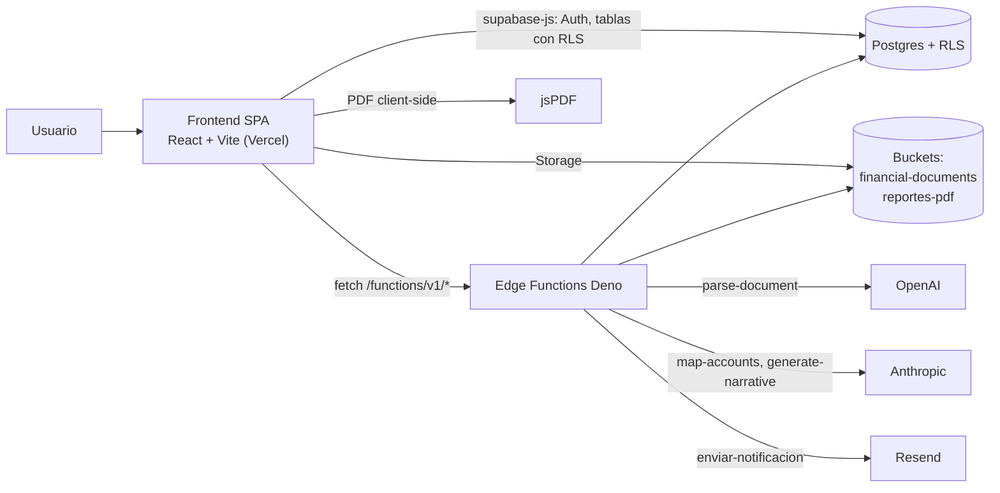
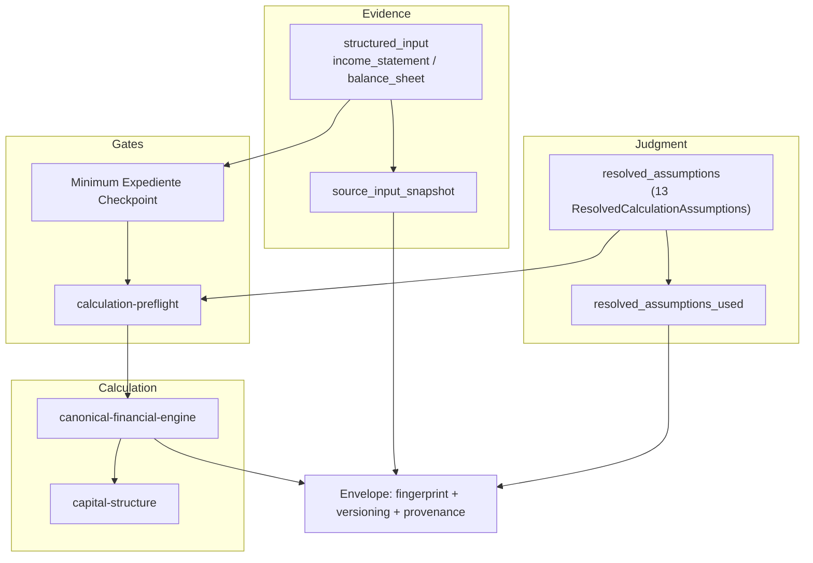

# Arquitectura

Volver a [[00-home]] · Contexto: [[01-contexto]] · Siguiente: [[03-modulos]] · Flujos: [[04-flujos]]

Capas: frontend ([[quick-model]], [[workbench]]) · backend ([[06-api]]) · persistencia ([[05-base-de-datos]]) · auth ([[07-autenticacion]]) · servicios externos ([[08-integraciones]]) · cálculo ([[motor-canonico]]) · deploy ([[14-deploy]])

## Vista general



## Frontend (`src/`)

- Entrada: `src/main.tsx` → `src/App.tsx` (React Router, `QueryClientProvider`, `AuthProvider`).
- Rutas: `/` (redirige a `/workbench` con sesión o a `/auth`), `/auth` (solo login y recuperación), `/workbench`, `/workbench/reviews/:revisionId`, `/reset-password`, `*`. `/dashboard/*` y `/admin/*` solo redirigen (compatibilidad con emails viejos). Todo lo de `/workbench` usa `ProtectedRoute`. No hay landing ni demo pública ([[ADR-006-retirar-landing-comercial]], [[ADR-007-personal-valuation-workbench]]).
- Alias `@` → `src/` (vite y vitest).
- Acceso a backend: `src/integrations/supabase/client.ts`, `src/lib/api-client.ts`, `src/lib/manual-review-api.ts`.
- Motor **cliente** (`src/lib/financial-engine.ts`): solo lo usa el [[quick-model]], que no es canónico.
- Workbench: `src/pages/Workbench.tsx` + `src/components/workbench/`. Ver [[workbench]].
- PDF: `src/lib/pdf-generator.ts` + `src/lib/pdf-canonical-mapper.ts` (se genera en el navegador a partir del snapshot canónico). Ver [[informes-pdf]].

Detalle de auth y rutas protegidas: [[07-autenticacion]].

## Backend (`supabase/`)

- `migrations/`: 10 migraciones SQL (2026-03-20 → 2026-08-17). Ver [[05-base-de-datos]].
- `rollback/` — rollback manual de la migración de protección de roles.
- `functions/<nombre>/index.ts` — 12 Edge Functions. Ver [[06-api]].
- `functions/_shared/` — lógica pura (sin Supabase, sin `serve()`, sin env) importable desde Deno **y** desde Vitest. Es donde vive el motor canónico y casi todos los tests.
- `config.toml` — todas las funciones con `verify_jwt = false`; cada una verifica autenticación explícitamente en su código (ver comentarios del archivo y [[07-autenticacion]]).

## Capas Evidence / Judgment / Calculation en código



Regla de [[05-financial-engine-audit]] §7: `source_input_snapshot` contiene **solo** evidencia; los supuestos resueltos se congelan en un snapshot separado (`resolved_assumptions_used`). Ver [[reproducibilidad]].

## Patrones encontrados

- **Módulos puros en `_shared/`**: cada Edge Function delega su lógica a un módulo puro testeable (`validation-rules.ts`, `account-taxonomy.ts`, `period-resolution.ts`, `authorization.ts`…).
- **Fail-closed**: el cálculo se bloquea (HTTP 409) si falla el checkpoint o el preflight; `parse-document` exige proveedor de IA configurado explícitamente.
- **Tests de especificación con `it.fails`**: comportamiento objetivo escrito antes que el código (Bloque 3B); al implementarse pasan a `it`.
- **Fixtures de caso real separados de fixtures sintéticos** (`alpina-2024.*` vs. `*.fixtures.ts`).
- **Auditoría por eventos**: casi todas las funciones escriben en `audit_events`.
- **Soft delete** en `analyses.deleted_at`.

## Convenciones de nombres

- Archivos: kebab-case (`calculation-preflight.ts`); componentes React en PascalCase.
- Tests: `*.test.ts`; tests de especificación v5 con sufijo `.v5.test.ts`; integración `.integration.test.ts`; regresión `.regression.test.ts`; casos dorados `.golden-cases.*`.
- Dominio y BD mayormente en español (`analyses.status = 'calculo_completo'`, `ejecutar-calculo`, `manual_reviews.estado`), tipos de motor en inglés.
- Commits: Conventional Commits (`feat:`, `fix:`, `test:`, `docs:`, `chore:`).

## Estructura de carpetas

Raíz única desde el 2026-10-15: `Velarix/velarix-code/` es a la vez repo git, carpeta de VS Code, proyecto de Claude Code y vault de Obsidian. Fuera de ella no queda contenido activo.

```
velarix-code/                    ← repo git + vault de Obsidian (origin: Paginas-Web-Henao/Velarix)
├── .obsidian/                   ← config del vault (workspace.json ignorado por git)
├── .claude/                     ← skill y comandos de Claude Code
├── src/                         ← frontend (workbench privado)
│   ├── pages/  components/{workbench,dashboard,demo,ui}/
│   ├── lib/  contexts/  hooks/  integrations/supabase/
│   └── data/velarix-datos-2026.ts  types/  test/
├── supabase/{migrations,rollback,functions/{_shared,…}}
├── scripts/{benchmark-ai,benchmark-narrative}/
├── docs/                        ← knowledge system
│   ├── 00-home.md … 15-glosario.md, 99-archive.md
│   ├── maps/ cases/ modules/ decisions/ skill/ research/ audits/
│   ├── archive/source-material/ ← PDF/DOCX originales de v1 (histórico)
│   ├── velarix-v5/              ← documentos canónicos v5.0
│   └── velarix/                 ← documentación histórica (auditoría, bloques, casos, fases)
├── evidence/benchmark/          ← JSONL de benchmarks de IA (2026-08-18; ignorado por git, D-11)
├── assets/brand/                ← logos de Velarix
├── public/  dist/ (build, ignorado)
├── velarix-code-latest/         ← snapshot viejo de Lovable, ignorado por git
└── *.zip, Negocio*.md           ← paquetes de bloques y docs de negocio v4.x (históricos)
```
