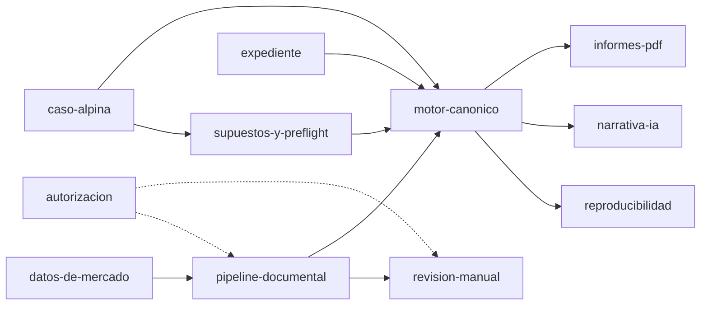

# Módulos

Volver a [[00-home]] · Anterior: [[02-arquitectura]] · Siguiente: [[caso-alpina]] · Cada módulo tiene su nota en `docs/modules/`.

Clasificación v5.0 tomada de [[01-scope-surgery]] §3 (KEEP / MODIFY / FREEZE) y del estado del repo.

## Núcleo financiero (v5.0)

| Módulo | Ubicación principal | Rol v5.0 |
|---|---|---|
| [[motor-canonico]] | `supabase/functions/_shared/canonical-financial-engine.ts`, `capital-structure.ts` | Calculation — fuente de verdad |
| [[supuestos-y-preflight]] | `_shared/resolved-calculation-assumptions.ts`, `calculation-preflight.ts` | Judgment → gate |
| [[reproducibilidad]] | `_shared/calculation-fingerprint.ts`, `calculation-versioning.ts`, `calculation-provenance.ts`, `*-snapshot.ts` | Trazabilidad |
| [[expediente]] | `_shared/minimum-expediente-checkpoint.ts` + 4 tablas | Evidence/Judgment mínimos |
| [[caso-alpina]] | `_shared/alpina-2024.*` | Caso único v5.0 |

## Pipeline de análisis

| Módulo | Ubicación principal | Rol |
|---|---|---|
| [[pipeline-documental]] | `upload-document`, `parse-document`, `map-accounts`, `validate-analysis`, `build-structured-input`, `run-analysis-pipeline` | Evidence: ingesta |
| [[revision-manual]] | `continuar-tras-revision`, `src/lib/manual-review-api.ts`, `src/pages/AdminReview*.tsx` | Gate humano |
| [[narrativa-ia]] | `generate-narrative`, `_shared/narrative-calculation-adapter.ts`, `_shared/anthropic-client.ts` | Borrador de texto |
| [[informes-pdf]] | `src/lib/pdf-generator.ts`, `src/lib/pdf-canonical-mapper.ts` | Salida |
| [[autorizacion]] | `_shared/authorization.ts`, `user-auth.ts`, `admin-key.ts` | Transversal |
| [[datos-de-mercado]] | `update-snapshots`, `check-data-freshness`, `src/data/velarix-datos-2026.ts` | Inputs externos |
| [[notificaciones]] | `enviar-notificacion` | Email transaccional |

## Frontend

| Módulo | Ubicación | Rol v5.0 |
|---|---|---|
| [[estimador-demo]] | `src/components/demo/`, `src/lib/financial-engine.ts` | Demo pública en `/`, sin login |
| [[dashboard]] | `src/pages/Dashboard.tsx`, `src/components/dashboard/` | Área privada (requiere auth) |

## Retirados

| Módulo | Estado | Decisión |
|---|---|---|
| [[landing]] | RETIRED, eliminado del código el 2026-10-15 | [[ADR-006-retirar-landing-comercial]] |

## Herramientas internas

| Módulo | Ubicación | Rol |
|---|---|---|
| [[benchmarks-ia]] | `scripts/benchmark-ai/`, `scripts/benchmark-narrative/` | Comparar proveedores IA |

## Dependencias entre módulos

