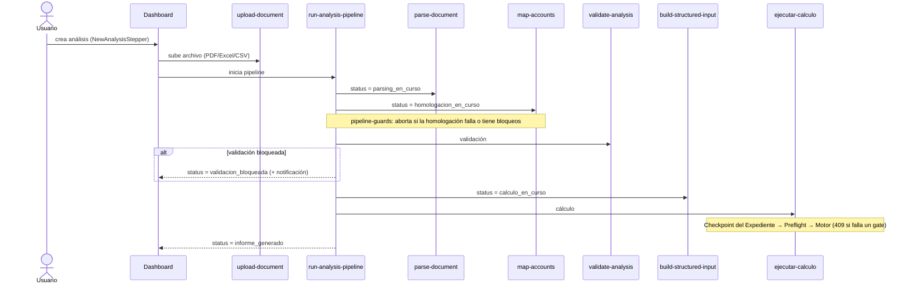
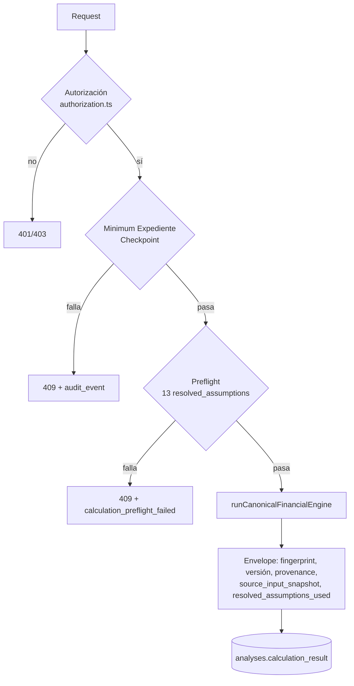

# Flujos

Volver a [[00-home]] · Relacionado: [[06-api]], [[05-base-de-datos]]

## 1. Pipeline de análisis (end-to-end)

Orquestado por `supabase/functions/run-analysis-pipeline/index.ts`; el frontend lo dispara desde `src/components/dashboard/DocumentUpload.tsx` (Workbench → Evidence → Cargar, o Nuevo caso).

Estados posibles (`analysis_status`): `creado`, `documentos_cargados`, `parsing_en_curso`, `parsing_completado`, `homologacion_en_curso`, `validacion_aprobada`, `validacion_con_advertencias`, `validacion_bloqueada`, `revision_manual_requerida`, `calculo_en_curso`, `calculo_completo`, `interpretacion_en_curso`, `informe_generado`, `error_tecnico`. El progreso visible se mapea en `src/hooks/useAnalysisProgress.ts`.

## 2. Cálculo (`ejecutar-calculo`)

Ver [[supuestos-y-preflight]], [[expediente]], [[motor-canonico]], [[reproducibilidad]].

## 3. Revisión manual

1. Se crea una revisión (`crearRevisionManual` en `src/lib/manual-review-api.ts`) → `analyses.status = revision_manual_requerida`. `generate-narrative` también puede dejar ese estado si su auditoría interna no pasa.
2. Un `analyst`/`admin` la toma, corrige cuentas, y aprueba o bloquea (Workbench → Review Center; detalle en `/workbench/reviews/:id`).
3. Al aprobar, se invoca `continuar-tras-revision`, que reconstruye el `structured_input` y deja el análisis en `validacion_aprobada`.

Ver [[revision-manual]] y [[07-autenticacion]].

## 4. Narrativa y PDF

- `generate-narrative` produce el texto a partir del `calculation_result` canónico (vía `narrative-calculation-adapter.ts`). No se encontró ningún componente del frontend que la invoque (solo existe `generateNarrative` en `api-client.ts`). > Pendiente de confirmar cómo se dispara hoy.
- El PDF se genera en el navegador con `pdf-generator.ts`, alimentado por `pdf-canonical-mapper.ts` (ligado al snapshot canónico, commit `5750fcf`).

## 5. Flujo metodológico del Expediente (v5.0)

Este es el flujo **conceptual** definido en la metodología; solo una parte está en código.

```mermaid
flowchart LR
  docs[Documentos] --> emp[Entender empresa] --> ctas[Entender cuentas] --> amb[Ambigüedades] --> preg[Preguntas] --> evi[Evidencia]
  evi --> norm[Normalización] --> hip[Hipótesis] --> met[Método] --> sup[Supuestos] --> calc[Cálculo] --> con[Contraste] --> concl[Conclusión]
```

En código existe: el checkpoint mínimo (contexto, ≥1 cuenta material, ≥1 ambigüedad, ≥1 tratamiento humano) y el contrato de supuestos resueltos. El resto está especificado en [[EXPEDIENTE-DE-VALORACION-V1]].

## 6. Caso Alpina (ruta usada hasta ahora)

`alpina-2024.structured-input.ts` + `alpina-2024.resolved-assumptions.ts` → `evaluateCalculationPreflight` → `runCanonicalFinancialEngine` dentro de Vitest (`alpina-2024.canonical-execution.test.ts`). La ruta oficial exigida por [[05-financial-engine-audit]] §1 es a través de `ejecutar-calculo`. Ver [[caso-alpina]].
