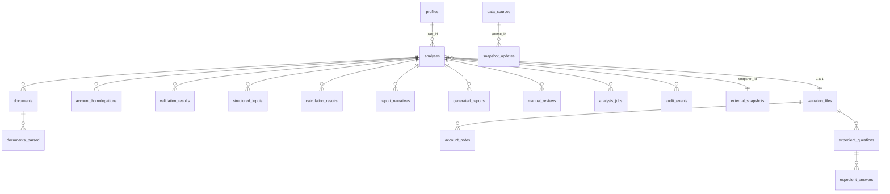

# Base de datos

Volver a [[00-home]] · Arquitectura: [[02-arquitectura]] · Relacionado: [[07-autenticacion]], [[06-api]]

Postgres gestionado por Supabase. Fuente de verdad: `supabase/migrations/*.sql`. Tipos TS generados: `src/integrations/supabase/types.ts`.

> [!warning] `types.ts` está desactualizado
> No incluye las 4 tablas del Expediente (`valuation_files`, `account_notes`, `expedient_questions`, `expedient_answers`) creadas en la migración `20260817140000`. Ver [[12-bugs]].

## Migraciones

| Archivo | Contenido |
|---|---|
| `20260320164123_…` | Enums (`analysis_status`, `validation_severity`, `confidence_level`, `doc_processing_status`) y tablas base con RLS |
| `20260320164136_…` | (sin DDL de tablas detectado) |
| `20260320180111_…` | `deleted_at`, `structured_inputs`, `manual_reviews`, `job_locks`, bucket de documentos, estado `revision_manual_requerida` |
| `20260322202441_…` | `analysis_jobs`, `data_sources`, `snapshot_updates`, `update_jobs_log`, `external_snapshots.macro_payload` |
| `20260322202933_…` | Índices de `manual_reviews` (estado, prioridad) |
| `20260323003518_…` | Bucket `reportes-pdf` (privado, 50 MB, solo PDF) + políticas |
| `20260409121703_…` | `analyses.moneda_analisis` (default `'COP'`) |
| `20260413152520_…` | `analyses.calculation_result jsonb` |
| `20260723090000_bloque_1d_bl10_role_protection` | Trigger anti auto-escalamiento de `profiles.role`, RPC `admin_set_user_role`, políticas de `manual_reviews` por rol. Rollback en `supabase/rollback/` |
| `20260817140000_minimum_expediente_checkpoint` | Tablas del [[expediente]] mínimo |

## Modelo de datos

## Tablas

### Análisis y pipeline
- **analyses** — `id, user_id, company_name, sector, expected_growth, status, validation_status, moneda_analisis, snapshot_id, input_payload, calculation_result, deleted_at, completed_at`.
- **documents** — `analysis_id, original_filename, storage_path, mime_type, doc_type_declared, checksum, processing_status`.
- **documents_parsed** — `document_id, parsed_structure, periods_detected, parsing_metadata`.
- **account_homologations** — `analysis_id, document_id, original_label, canonical_account, category, value, period, confidence_score, ambiguity_flag, mapping_notes`.
- **validation_results** — `analysis_id, rule_code, severity, status, blocking_flag, detail`.
- **structured_inputs** — `analysis_id, input_payload, version_input`.
- **calculation_results** — `analysis_id, engine_version, input_payload, output_payload`.
- **report_narratives** — `analysis_id, executive_summary, sections_payload, audit_passed, audit_notes, generation_version`.
- **generated_reports** — `analysis_id, file_path, report_version`.
- **analysis_jobs** — `analysis_id, job_type, status, progreso_pct, progreso_mensaje, input_payload, output_payload, error_mensaje`.
- **job_locks** — `job_key, locked_by, locked_at, expires_at` (solo service role).
- **audit_events** — `analysis_id, user_id, component, event_type, event_detail, metadata`.

### Revisión humana
- **manual_reviews** — `analysis_id, requested_by, reviewed_by, estado, prioridad, reason, cuentas_a_revisar, correcciones, resolution, resolution_notes, resolved_at`.

### Expediente mínimo
- **valuation_files** — 1:1 con `analyses`.
- **account_notes** — `canonical_account, interpretation_text`.
- **expedient_questions** — `texto, razon, materialidad (alta|media|baja), generado_por_ia, estado (abierta|respondida|evaluada|cerrada)`.
- **expedient_answers** — `question_id, respuesta_texto, respondido_por`.

### Datos de mercado
- **external_snapshots** — `sector, effective_date, data_payload, macro_payload, source_version`.
- **data_sources**, **snapshot_updates**, **update_jobs_log** — catálogo de fuentes, cambios por parámetro y log de jobs.

### Usuarios
- **profiles** — `id, full_name, company, role`.

## RLS (resumen)

- Tablas de análisis: acceso por propietario (`auth.uid()` = dueño del análisis).
- `manual_reviews`: el dueño ve/solicita las suyas; `analyst`/`admin` ven y actualizan todas.
- Tablas del Expediente: solo `analyst`/`admin`.
- `external_snapshots`, `data_sources`, `snapshot_updates`, `update_jobs_log`: lectura para autenticados.
- `job_locks`: solo service role.

## Storage

| Bucket | Público | Regla |
|---|---|---|
| `financial-documents` | No | Carpeta = `auth.uid()` |
| `reportes-pdf` | No | Carpeta = `auth.uid()`, 50 MB, `application/pdf` |
