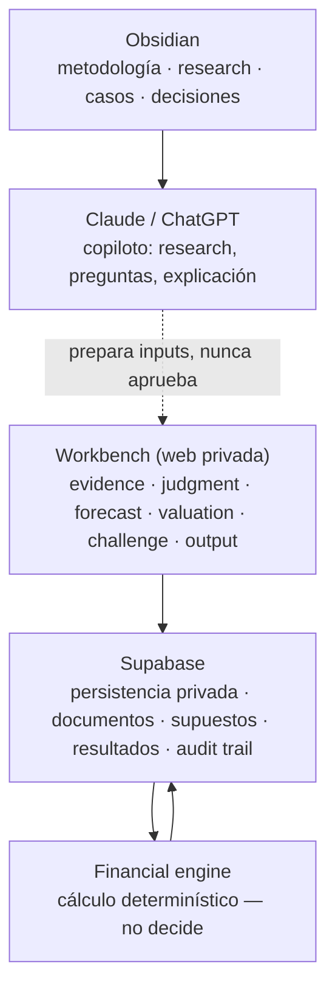

# ADR-007 — Velarix como Personal Valuation & Projection Workbench

Índice: [[09-decisiones]] · Antecedentes: [[ADR-001-redefinicion-v5]], [[ADR-006-retirar-landing-comercial]] · Auditoría: [[personal-workbench-surgery-2026-10-15]]

## Contexto

Velarix dejó definitivamente de perseguir cualquier objetivo comercial. La landing ya se retiró con [[ADR-006-retirar-landing-comercial]].

La demo pública tampoco aporta al objetivo final: el sistema no pretende adquirir usuarios ni mostrar una versión gratuita. Fue una etapa intermedia: ADR-006 la dejó en `/` sin login.

## Decisión

Velarix se convierte en **Personal Valuation & Projection Workbench**: el sistema personal de Nicolás para estudiar empresas, organizar Evidence, normalizar estados financieros, proyectar, documentar Judgment, ejecutar Calculation determinístico y producir valoraciones defendibles, trazables y reproducibles.

La aplicación web existe únicamente como **interfaz operativa** del sistema. No es el producto. El proyecto real es:

**metodología + knowledge system (Obsidian) + financial engine + case files + workbench + AI copilot**

Regla central: **Evidence ≠ Judgment ≠ Calculation**. El motor calcula, la metodología gobierna y el humano decide.

## Consecuencias

- La raíz de la aplicación deja de ser una demo pública: `/` redirige a `/workbench` con sesión o a `/auth` sin ella.
- `/workbench` es la única vista de trabajo. `/dashboard` y `/admin/revisiones` se absorben y solo quedan redirecciones de compatibilidad.
- El Estimador pasa a ser **Quick Model**: local, exploratorio y **no canónico**. No se unifica con el motor canónico (sigue `NOT BUILDING`).
- Sin registro público: el login solo inicia sesión o recupera la contraseña.
- El entregable 4 del roadmap v5.0 ("Estimador como demo pública sin login") queda **superado**: no hay demo pública.
- Supabase vuelve a ser central como **Private Valuation Data Layer**. Se conservan Auth, RLS, Storage y las Edge Functions.

## Propuesta de simplificación de roles (no ejecutada)

**Hoy:** `profiles.role ∈ {user, analyst, admin}`. Es herencia del modelo boutique: el dueño del análisis no podía aprobar su propia revisión. En un sistema personal es la **única barrera técnica contra la auto-aprobación silenciosa**, y además da acceso de lectura y escritura al Expediente (RLS por rol).

**Propuesta para decidir:**

1. **Opción A (recomendada a corto plazo): no tocar nada.** La cuenta personal tiene rol `admin`. Coste: cero. El modelo queda conceptualmente sobredimensionado, pero funciona.
2. **Opción B: dueño único.** Migración nueva que haga el RLS del Expediente y de `manual_reviews` por `auth.uid()` = dueño del análisis. Elimina `analyst` y deja `admin` solo para `admin_set_user_role`. Ajusta `authorization.ts` para que el dueño apruebe con un registro explícito de Judgment (quién y cuándo) en `audit_events`.
   - Riesgo: toca RLS, `authorization.ts`, los tests de 1D y la Edge Function `continuar-tras-revision`.
   - Requiere migración remota: **no se ejecuta sin confirmación**.

`manual_reviews` tiene valor funcional real: es la cola de **Judgment review** sobre homologaciones dudosas, validaciones bloqueadas y narrativas que no pasan su auditoría. Se conserva como "Review Center" dentro del workbench.

## Fuente

Rama `personal-workbench`, commit `1a52f2e` y siguientes.
