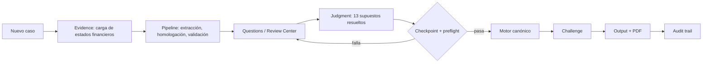

# 03 — Workbench

[[00-home]] · Anterior: [[02-SYSTEM]] · Siguiente: [[04-CASES]]

La web es la **interfaz operativa**, no el producto ([[ADR-007-personal-valuation-workbench]]). Prioridades de UX: claridad > densidad útil > trazabilidad > jerarquía > rapidez > consistencia > estética.

## Notas
- [[workbench]]: rutas, secciones A–K y de dónde sale cada dato.
- [[quick-model]]: modelo rápido **no canónico** frente al caso canónico.
- [[revision-manual]]: Review Center (Judgment review).
- QA: `src/components/dashboard/QAChecklist.tsx` (Valuation QA Checklist).

## Ciclo de vida de un caso

Paso a paso con la IA: [[VELARIX-VALUATION-SKILL]] (Workflow).

## Rutas
`/` → `/workbench` (sin login, single-owner) · `/workbench` · `/workbench/reviews/:id`. `/auth` y `/reset-password` están retiradas y redirigen al workbench. Sidebar: casos, Quick Model, Review Center, QA, **Settings**. Detalle en [[07-autenticacion]] y [[ADR-008-single-owner-private-mode]].
